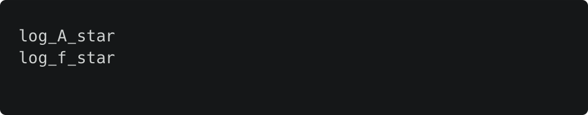
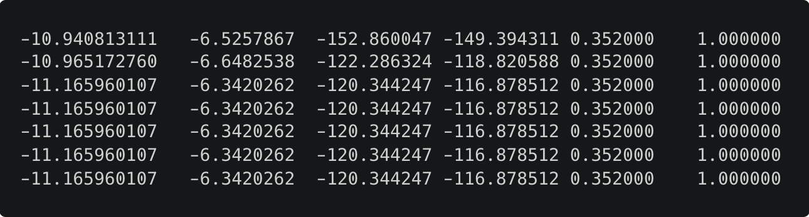
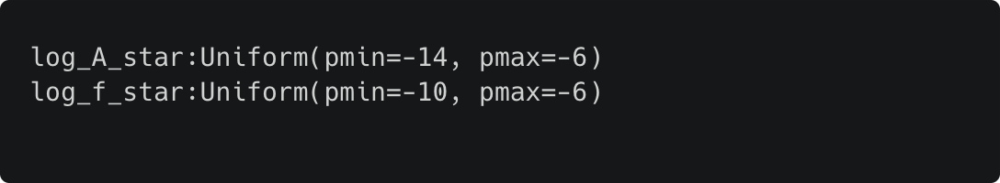

# Output
The structure of the PTArcade output is the following:
```{ .sh .no-copy }
out_dir/ # (1)!
└── name/ # (2)!
    └── chain_0/
        ├── chain_1.txt
        ├── pars.txt
        ├── priors.txt
        └── ...
```

1.  By default, `out_dir = ./chains`. The user can specify a different 
output directory via the [configuration file][out].
2.  By default, `name=np_model`. The user can specify a different 
name in the [model file][name].

With [`mod_sel = True`][mod_sel], the directory is `name_mod_sel/` instead, so that a
model selection run never overwrites a run of the same model without it.

The SMBHB parameters are `gw_bhb_log10_A` and `gw_bhb_gamma`, or `gw_bhb_0` and
`gw_bhb_1` (the log amplitude and the spectral index) with the theory-motivated prior,
which samples them jointly. A new-physics model with `smbhb = True` names its own
`gw_bhb_np_*` in enterprise mode, so that they stay apart from the SMBHB-only model's in
model selection.

The output generated by PTArcade matches that of [ENTERPRISE]
and it includes, beyond the MC chains, a number of files which summarize
key information on the run and the MC sampler. For our purposes,
the most important files produced by PTArcade are:

[`pars.txt`](#+out.pars){ #+out.pars }

:   This file contains the names of the model parameters. The order in 
    which the parameters appear in this file will also dictate the order 
    in which the parameters appear in the `chain_1.txt` file.

    When running with `mode="ceffyl"`, the `pars.txt` file for the example
    model discussed in the [introduction] will read as follows: (1)
    { .annotate }

    1.  When running with `mode = "enterprise"`, in addition
    to the user-specified parameters, `pars.txt` will also include intrinsic
    red noise parameters (two per pulsar) and, in the case of the IPTA dataset,
    DM parameters. 

    

[`chain_1.txt`](#+out.chain){ #+out.chain }

:   This file contains the MC chains. It is formatted such that each
    line represents an MC sample and each column corresponds to a 
    parameter of our model. The ordering of the parameters, i.e., which 
    column is associated to each parameter, can be read out from the 
    [`pars.txt`](#+out.pars) file. (1) 
    { .annotate }

    1.  Note that, when running with `mode = "enterprise"`, in addition
    to the user-specified parameters, the chains will also include intrinsic
    red noise parameters (two per pulsar) and, in the case of the IPTA dataset,
    DM parameters. 

    In addition to the model parameters, the last four columns of each row 
    report the values of the posterior, the likelihood, the acceptance rate, and 
    an indicator variable for [parallel tempering], which does not matter 
    in our case since PTArcade does not use [parallel tempering].

    For the example model discussed in the [introduction], the 
    output of a run in Ceffyl-mode will be: 

    

    Here, the first two columns give the values of $\log_{10}A_*$ and 
    $\log_{10}(f_*/{\textrm Hz})$ while the remaining columns give the 
    value of the posterior, the likelihood, the acceptance rate, and the parallel-tempering
    indicator.
    
[`priors.txt`](#+out.priors){ #+out.priors }

:   The prior file is similar to the `pars.txt` file, but, in addition to 
the parameter names, it also includes their prior distributions. Here is an example for our test
model, when running in Ceffyl-mode:

    

[out]: ./inputs/config.md#+config.out_dir
[mod_sel]: ./inputs/config.md#+config.mod_sel
[name]: ./inputs/model.md#+model.name
[ENTERPRISE]: https://github.com/nanograv/enterprise
[introduction]: ./getting_started/index.md
[parallel tempering]: https://en.wikipedia.org/wiki/Parallel_tempering
